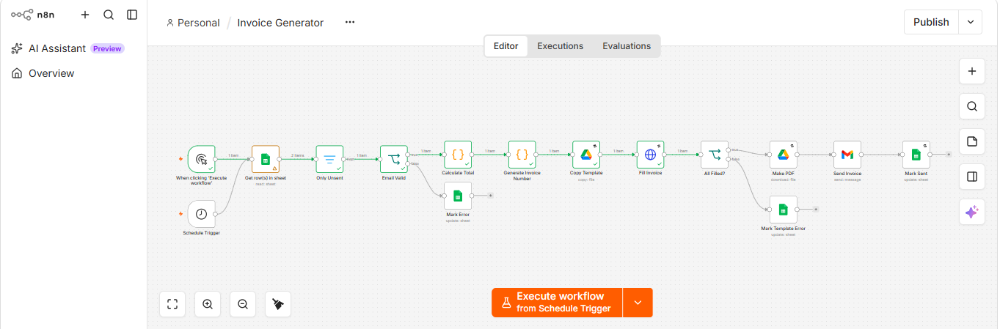
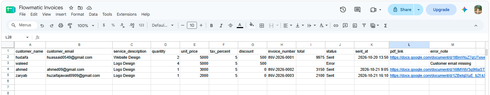
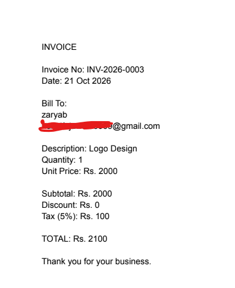
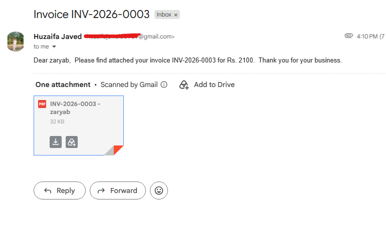
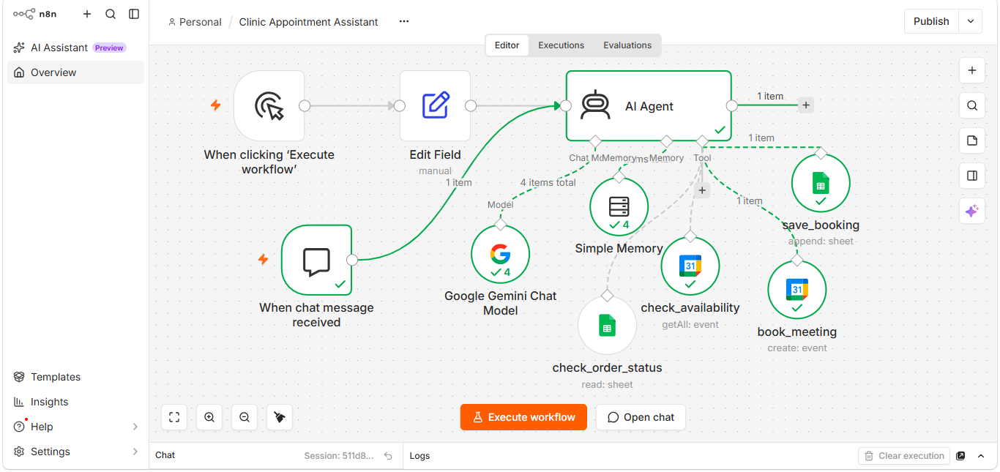
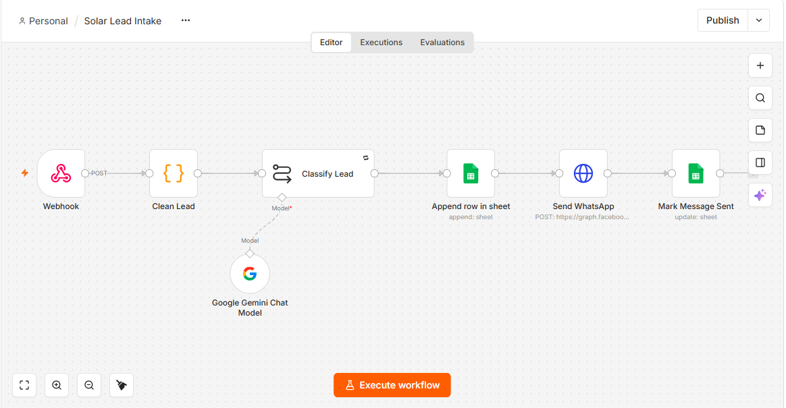
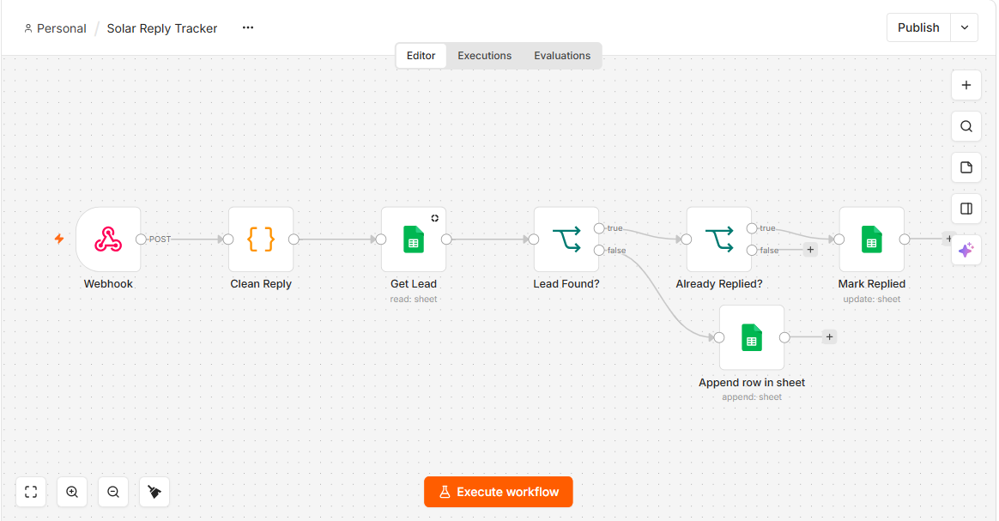
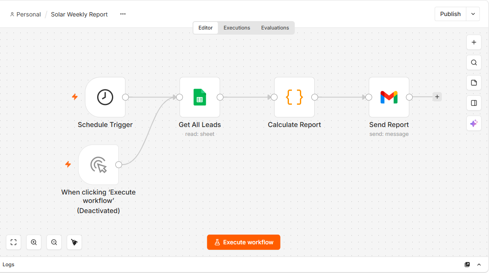
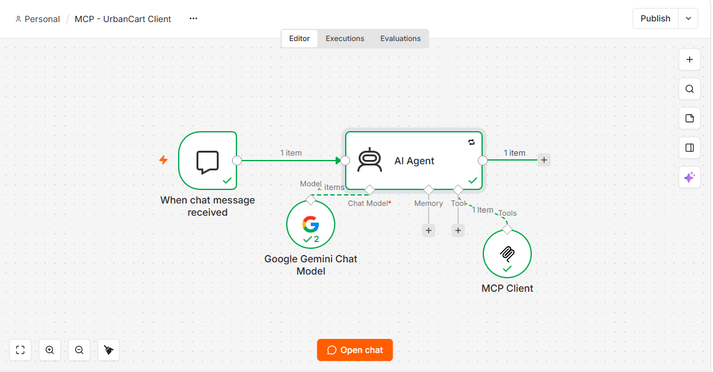
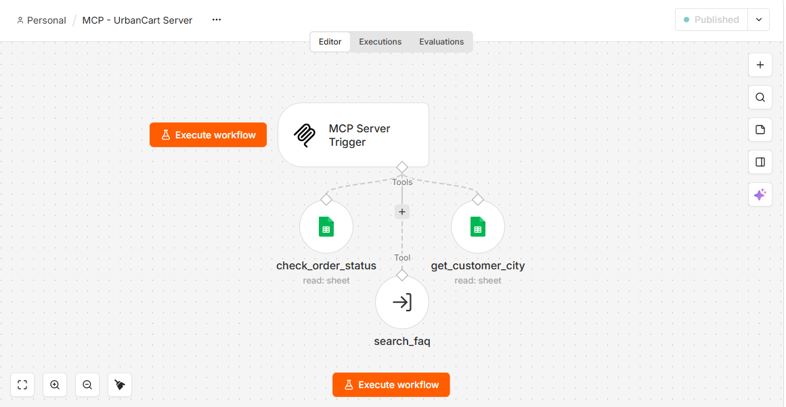

# flowmatic-ai-automation-portfolio
AI Automation projects built for real business use-cases
# Flowmatic — AI Automation Portfolio

Real, tested AI automation projects built for actual business use-cases. 
Each project below solves a genuine business problem using AI + no-code automation tools.

📄 Full case studies with business impact: [View on Notion](https://app.notion.com/p/Flowmatic-AI-Automation-Portfolio-3db68afcc5888009aee4d5b5cc4181aa?t=3db68afcc588807b95b300a95a2b0234)

---

## Project 1: Invoice Generator

**What it does:** Creates and emails a professional PDF invoice automatically from a single row in Google Sheets.

**The problem:** Small businesses often write each invoice by hand, calculate totals manually and email it themselves. This is slow and easy to get wrong.

**The solution:** The business adds one row with the customer details. The system calculates the total, assigns a unique invoice number, creates the PDF from a branded template, emails it to the customer and marks the row as Sent.

**How it works**
1. A new row is added to the spreadsheet.
2. The system calculates the total and creates the invoice PDF.
3. The invoice is emailed to the customer.
4. The row is marked as Sent.

**Key features**
- Unique, sequential invoice numbers (INV-2026-0001)
- Total, discount and tax calculated automatically
- Never sends the same invoice twice
- Rows with a missing email are flagged "Error" with a reason
- Stops if the template is damaged, instead of sending a wrong invoice
- Retries automatically on temporary network failures
- Checks for new rows every 5 minutes

**Tech stack:** n8n, Google Sheets, Google Docs, Google Drive, Gmail

## Project 2: AI Clinic Appointment Assistant

**Problem:** Clinics lose time and bookings to manual phone-call scheduling. Staff have to check the calendar, call the patient back, and log the appointment manually — slow and error-prone.

**Solution:** A conversational AI agent that understands a patient's request, checks real-time doctor availability, confirms the time, books the appointment, and logs the record automatically — no human needed.

**Tech Stack:** n8n, Google Gemini AI, Google Calendar API, Google Sheets

**How it Works:**
1. Patient sends a message → AI understands the request
2. Assistant checks doctor availability on Google Calendar
3. Confirms the time and patient details
4. Books the appointment automatically
5. Logs the booking (name, phone, time, status) to Google Sheets

**Result:** Fully automated, tested end-to-end appointment booking system — verified working in both Google Calendar and Google Sheets.

## Project 3: Solar Lead Follow-up & Reporting System

**Problem**
Solar companies generate leads from multiple channels, such as Facebook, Instagram, TikTok, Google Ads and website forms. Leads are slow to receive a response, follow-ups get forgotten, and the owner has no clear weekly view of how many leads actually engaged.

**Solution**
A source-independent lead management system built on n8n. Any channel that can send lead data to a webhook feeds one pipeline: instant WhatsApp response, AI lead qualification, automatic follow-up, reply tracking, and a weekly performance report for the business owner.

**Tech Stack**
n8n, Gemini API, Google Sheets, WhatsApp Cloud API, Gmail

**How It Works**
1. **Lead Intake:** each new lead is normalized (phone format), classified by AI as serious, normal or cold, stored in Google Sheets, and sent a WhatsApp message.
2. **Automated Follow-up:** an hourly check finds leads with no reply after 24 hours and sends exactly one follow-up.
3. **Reply Tracking:** a reply updates the lead status and records the time of the first reply. Repeat replies never overwrite it, and messages from unknown numbers are logged in a separate tab instead of being lost.
4. **Weekly Report:** every Sunday the owner receives an email with total leads, quality breakdown, reply rate, follow-ups sent, average first-response time, and serious leads still waiting for a reply.

**Result**
- First WhatsApp response goes out within seconds of a lead arriving
- One message per lead, with no duplicate follow-ups
- Reports are calculated by code rather than AI, so the numbers are exact

## Project 4: UrbanCart Support Agent v2 (RAG + AI Agent + MCP)

**Problem:** Online stores get the same customer questions all day (delivery, returns, order status) and answering them manually is slow. Order lookups also risk exposing customer data.

**Solution:** An AI support agent that answers policy questions from the store's own knowledge base and checks order status for verified customers, while keeping private customer data out of the AI's reach.

**Tech Stack:** n8n, Google Gemini, Pinecone (vector database), Model Context Protocol (MCP), Google Sheets

*The customer-facing agent (first image) connects to a separate tool server (second image) that handles store data and order lookups.*

**How it works:**
1. Customer asks a question in plain Roman Urdu or English
2. The agent decides what is needed: a policy answer, an order check, or both
3. Policy questions are answered from the store's own documents
4. Order questions go through a dedicated tool server, so the agent only sees the information it needs
5. Wrong or missing details get a polite request to re-check, never a guess

**Result:** A support agent built for online stores that answers policy and order questions in a single reply, in Roman Urdu or English. It keeps customer data private and can be customized for any store's products and policies.

---
## Project 5: AI-Powered WhatsApp Lead Bot

**Problem:** Businesses lose leads because they can't reply to WhatsApp messages instantly, 24/7. Manual replies are slow and inconsistent.

**Solution:** An automated pipeline that receives a customer's WhatsApp message, generates a smart AI-powered reply based on the business's tone/instructions, logs the lead, and sends the reply back — all within seconds, no human needed.

**Tech Stack:** Make.com, Meta WhatsApp Business Cloud API, Google Gemini AI, Google Sheets

**How it Works:**
1. Customer sends a WhatsApp message → Webhook receives it
2. Google Gemini AI reads the message and generates a professional, on-brand reply
3. Lead details (name, number, message, timestamp) are logged into Google Sheets
4. AI-generated reply is sent back to the customer via WhatsApp API

**Result:** Fully automated, tested end-to-end lead response system — reduces response time from hours to seconds, works even outside business hours.

---
## Project 6: AI Customer Support Ticket Classifier

**Problem:** Support teams waste time manually reading every customer ticket to figure out what it's about and how urgent it is — this delays response to critical issues.

**Solution:** An automated system that receives a customer support message, uses AI to instantly classify it by category and priority level, and logs it in an organized format — so teams can act on urgent tickets first.

**Tech Stack:** n8n, Google Gemini AI, Google Sheets

**How it Works:**
1. Customer support message comes in via Webhook
2. Google Gemini AI analyzes the message and classifies it (category + priority)
3. A Code node parses the AI's response into clean structured data
4. Ticket details (customer name, email, message, category, priority) are saved to Google Sheets

**Result:** Instant, consistent ticket triage — no more manual sorting, urgent issues get flagged automatically.
